# Diktatūra — galerija

Visos nuotraukos — iš **išgalvotų** demo duomenų (`tools/screenshots.sh` → `tools/gallery.py`): vardai, tekstai ir
įrašai netikri. Langai piešiami atmintyje (GTK broadway), tikri duomenys neliečiami.

## 📄 Tekstas

Gyvai besipildančios transkripcijos: kalbėtojai vardais ir spalvomis, sesijų skyrikliai, ⭐ žymės ir ☐ užduotys.
Viršuje — 🌊 garso banga: „Tu" (mikrofonas) ir „Kolegos" (sistemos garsas) atskirai, kolegų juosta nuspalvinta to,
kas tuo metu kalba, spalva; eilučių žymės viršuje. Spragtelėjus bangą — groja nuo tos vietos, ratukas — artina.

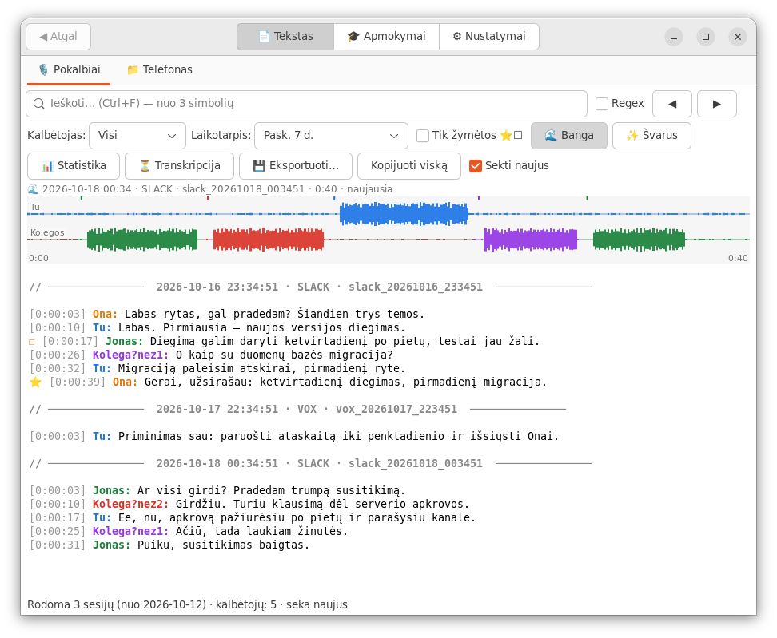

Paieška (nuo 3 simbolių, Regex, ◀ ▶, Ctrl+F) — rasta paryškinama:

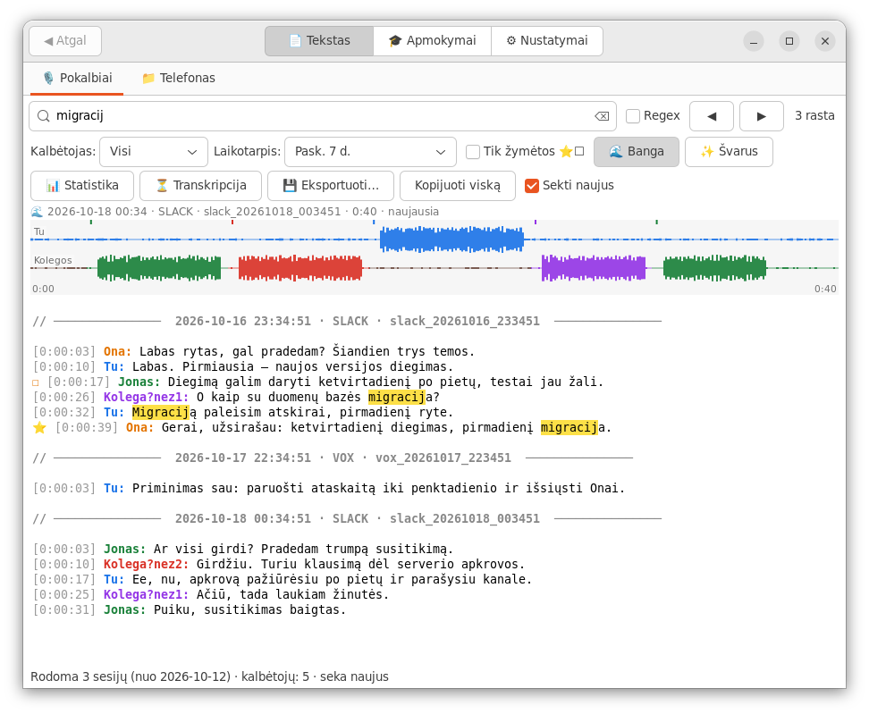

Dešinys spragtelėjimas ant eilutės: ▶ groti nuo čia, ⭐ / ☐ žymės, 🎓 priskirti vardą nežinomam balsui,
✎ Kas kalbėjo? (pataisyti kalbėtoją — balsas išmokstamas), 🔁 transkribuoti sesiją iš naujo:

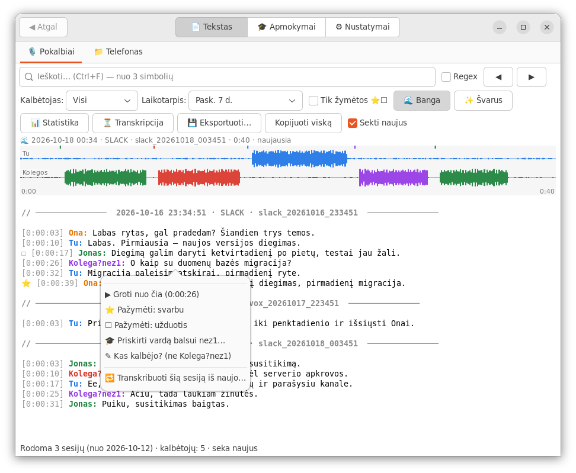

✨ Švarus tekstas — be „ee", „nu", „mhm" ir pasikartojimų (taisyklėmis, failai nekeičiami; žodžiai — Nustatymuose):

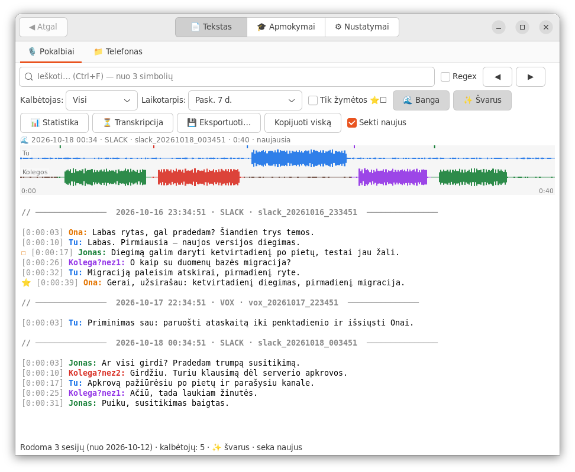

📱 Sekamo aplanko skirtukas (telefonas, laikrodis, studija): tekstai atskirai nuo pokalbių, viršuje — aplankas,
kiek failų laukia, „🔄 Transkribuoti dabar":

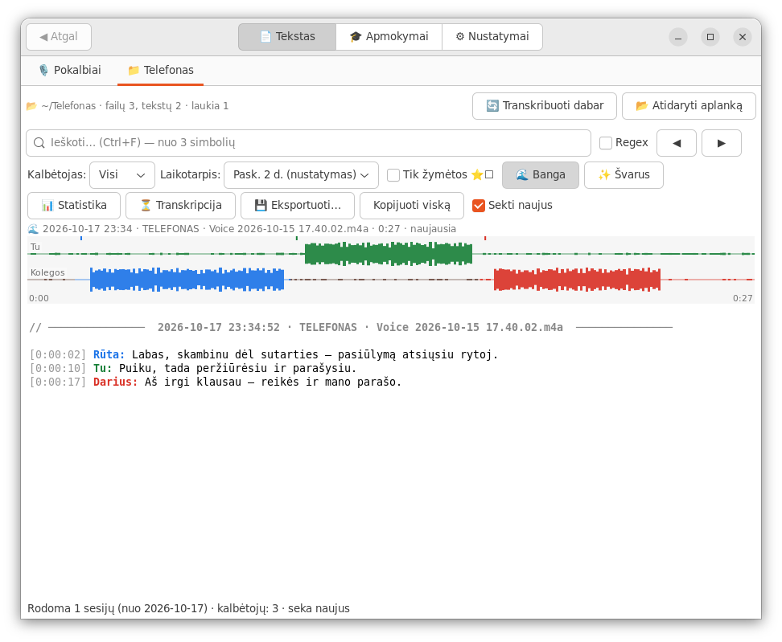

## ⏳ Transkripcijos eiga

Kaip Midnight Commander kopijuojant: dabartinis failas (etapas, banga su apdorota dalimi, praėjo / liko / kada baigs)
ir visa eilė; laukiantys failai su prognozėmis; „⏭ Praleisti šį" / „⏹ Sustabdyti viską":

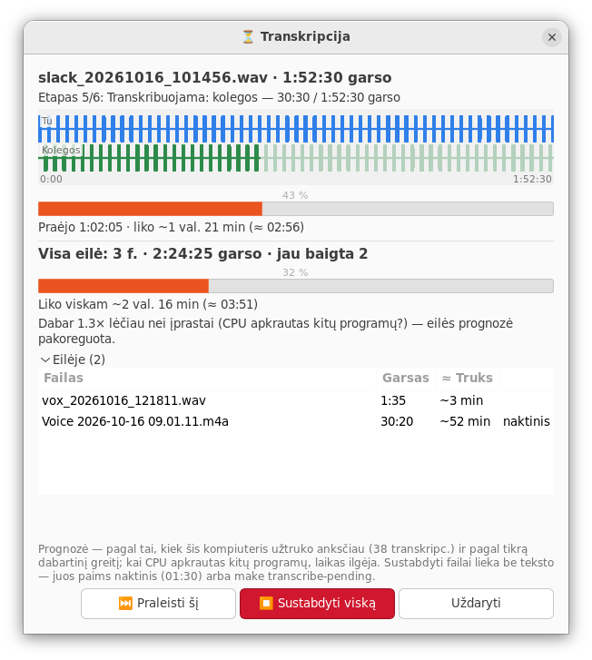

## 💊 Įrašymo indikatorius

Ekrano kampe, kol įrašoma: gyva abiejų kanalų banga ir laikmatis („ar mane girdi?"); po įrašo — transkripcijos eiga:

## 🎓 Apmokymai

Nežinomas balsas („Kolega?nez1") — paklausai, matai ką sakė, įrašai vardą; nuo tada atpažįstamas automatiškai:

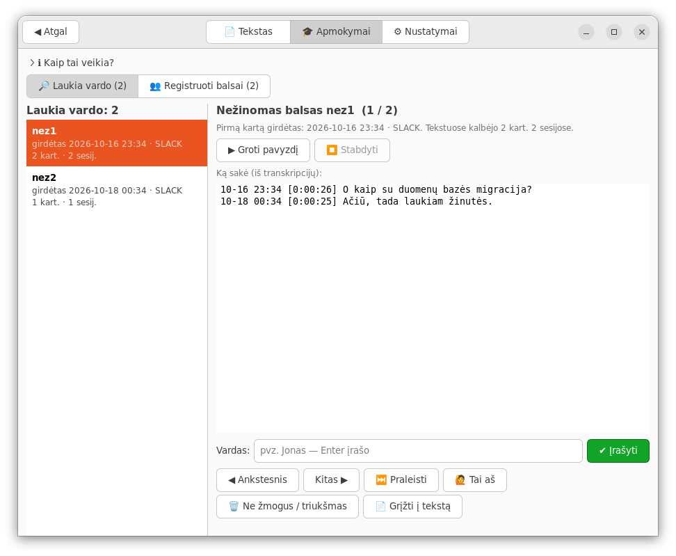

## ⚙ Nustatymai

Viskas su paaiškinimais lietuviškai; taikoma iškart, be perkrovimo:

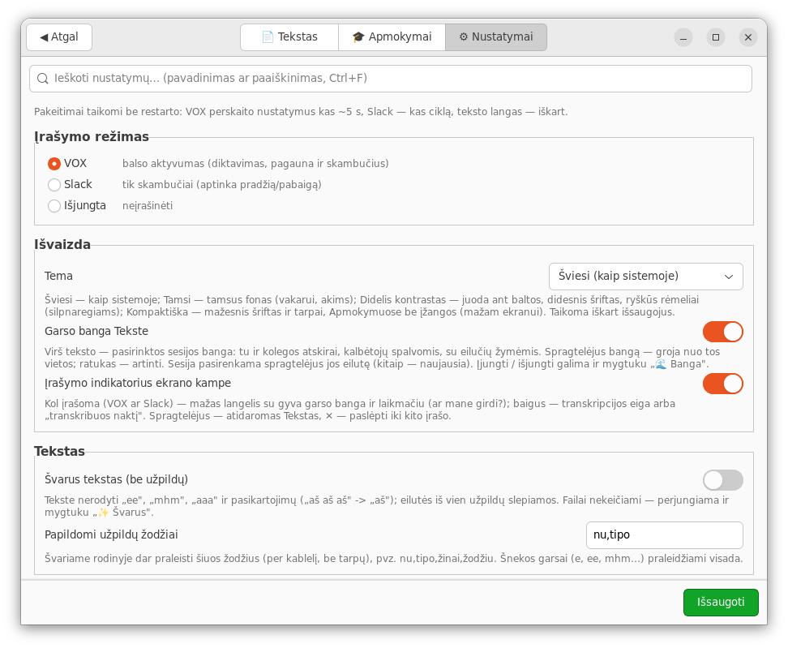

🔍 Paieška (Ctrl+F): lieka tik susiję nustatymai, rastas tekstas paryškintas; lietuviškos raidės nesvarbios:

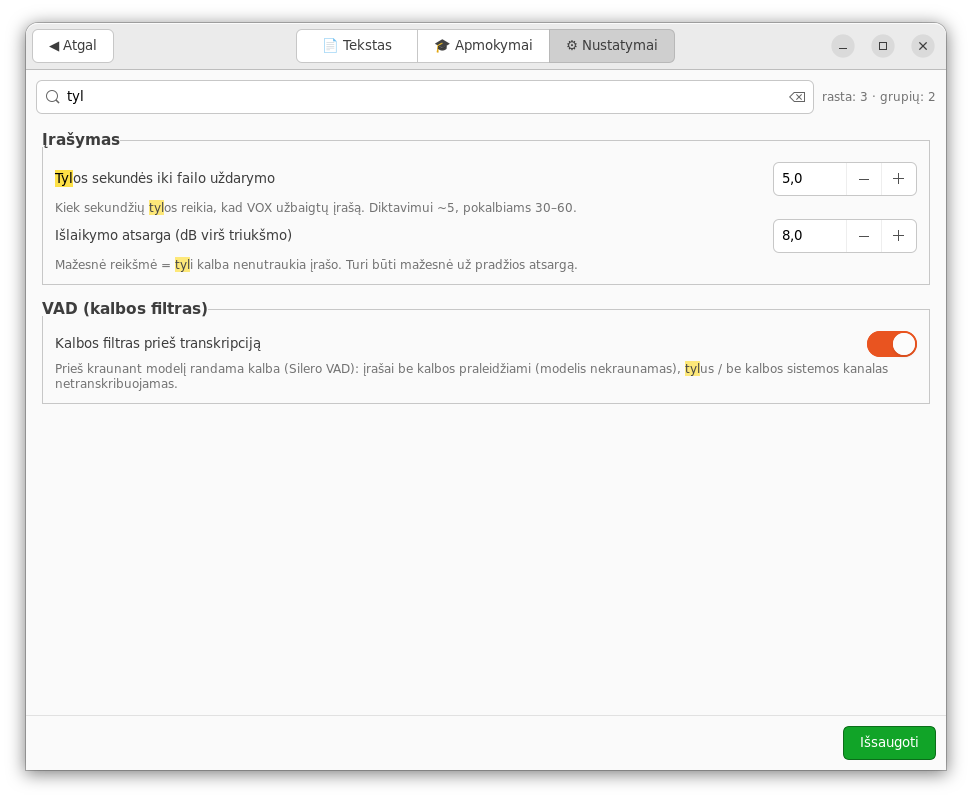

📱 Sekami aplankai — pridėti, įjungti / išjungti, nebesekti (tavo failai nekeičiami ir netrinami):

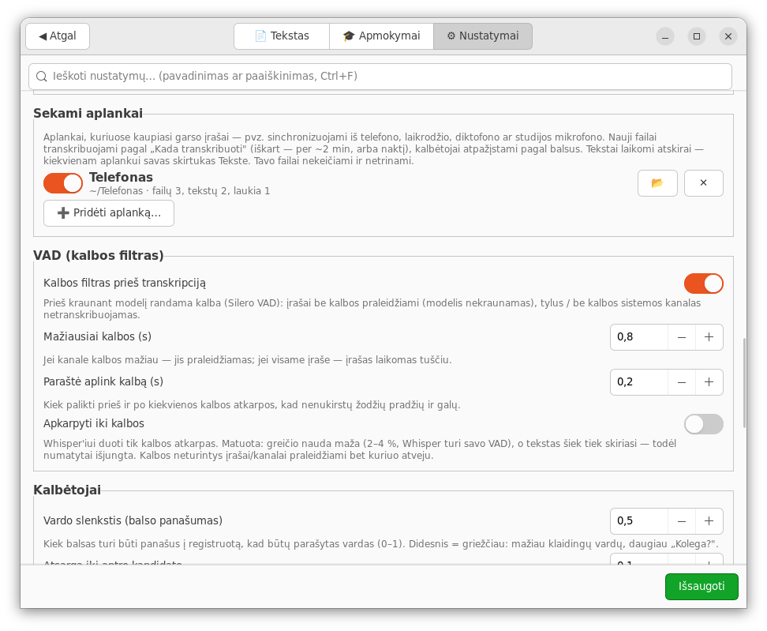

## 🎨 Temos

| Tamsi | Didelis kontrastas ir šriftas |
|---|---|
| 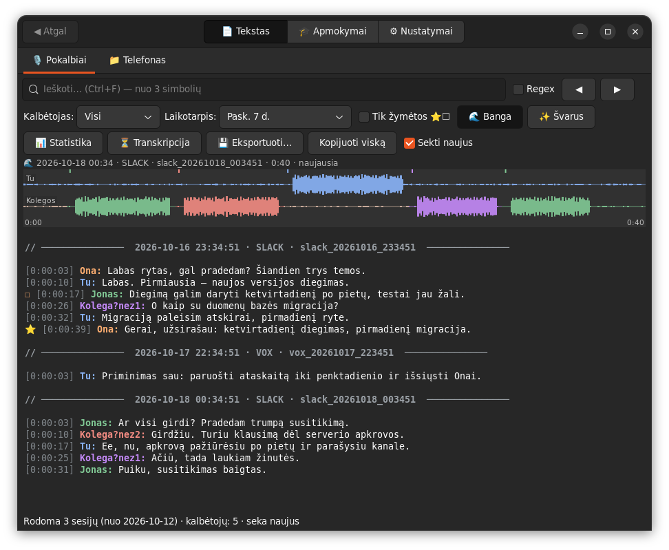 | 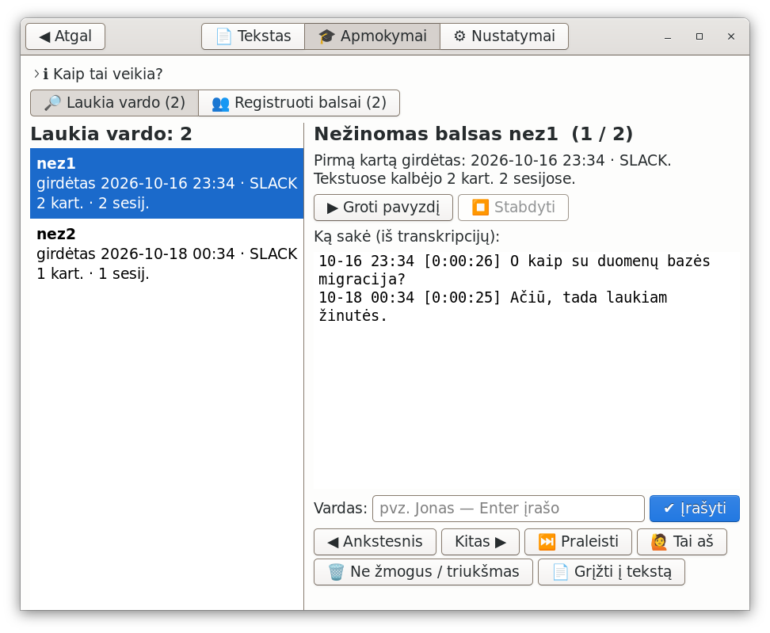 |

Kompaktiška (mažam ekranui — 680×420):

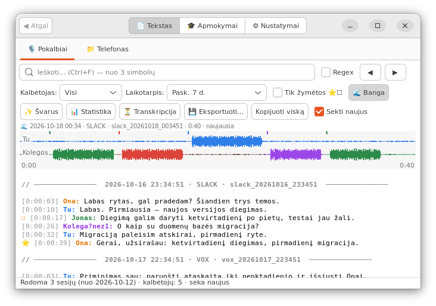

## Status bar ikona

⚪ budi · 🔴 įrašo · 🟡 apdoroja; pulsuoja, kai laukia nežinomų balsų:

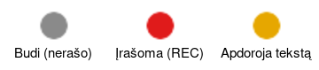
